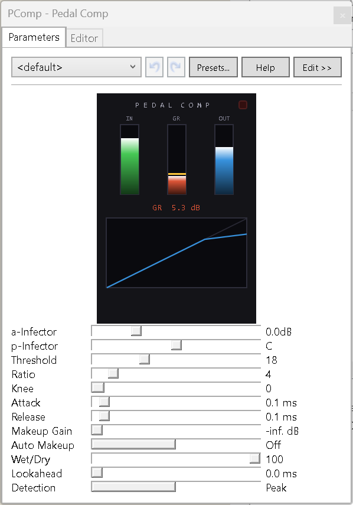

# Pedal Comp for Buzz 1503

A clean, efficient stereo compressor effect for **Jeskola Buzz 1503 (32-bit)**.
This is the Buzz 1503 port of Pedal Comp 1.3 for
[ReBuzz](https://github.com/wasteddesign/ReBuzz): same DSP, same meter panel.



---

## Features

- **Hard or soft knee**: knee width from 0 (hard) to 12 dB, a smooth quadratic curve
- **Peak or RMS detection**: peak for precise transient control, RMS (10 ms window) for smoother bus compression
- **Program-dependent release**: release shortens automatically on sudden signal drops, reducing pumping
- **Lookahead**: up to 20 ms delay on the audio path so the detector sees transients before they arrive
- **Wet Dry mix**: parallel compression; the dry path is time-aligned through the lookahead buffer
- **Auto makeup gain**: computes output compensation from threshold and ratio
- **Output soft-clip**: gentle saturation above about -0.9 dBFS instead of hard clipping
- **Display panel** at the top of the parameter window, stretching to its width:
  - IN, GR and OUT meters with GR peak hold, and a SAT light (lights in the soft-clip zone, clears after about 2 s, click to reset)
  - Transfer curve with a dot at the current detector level, so you can see whether the signal sits below, in or above the knee
  - **4-second history**: input level (green) and output level (blue) from the bottom on a -60 to 0 dBFS scale, gain reduction (red) hanging from the top on a 0 to 20 dB scale, threshold as a dashed line, a mark every second. Shows pumping and whether the release recovers between hits. Kept by the machine, so it carries on while the window is closed
  - Readout of the settings as they act on the audio: threshold, ratio, knee, attack and release in ms, the makeup actually applied (including Auto Makeup's value), mix, lookahead in ms and samples, and peak in and out levels over the last 3 seconds
- **Sleeps when idle**: a muted or silent input costs almost nothing

---

## Parameters

| # | Parameter | Range | Default | Description |
|---|---|---|---|---|
| 0 | Threshold | 0 dB to -60 dB | -18 dB | Compression threshold. |
| 1 | Ratio | 1 to 30 | 4 | Ratio N to 1. 1 = no compression, 30 = near-limiting. |
| 2 | Knee | Hard, 1 to 12 dB | Hard | Soft-knee width. |
| 3 | Attack | 1 to 200 ms | 10 | How fast the compressor responds to rising levels. |
| 4 | Release | 10 to 2000 ms | 100 | How fast it recovers. Shortens automatically on sudden drops. |
| 5 | Makeup Gain | 0 to +24 dB | 0 dB | Output gain. Ignored when Auto Makeup is on. |
| 6 | Auto Makeup | Off, On | Off | Makeup computed from threshold and ratio. |
| 7 | Wet Dry | 0% to 100% | 100% | Blend between compressed and dry signal. |
| 8 | Lookahead | Off, 1 to 20 ms | Off | Delay on the audio path. Adds equivalent latency. |
| 9 | Detection | Peak, RMS | Peak | Envelope detection mode. |

Parameter order and stored values are identical to the ReBuzz version.
Differences you will see in Buzz 1503:

- `Wet/Dry` is named **Wet Dry** (a slash is not safe in Buzz parameter names).
- Threshold, Knee, Makeup Gain, Wet Dry and Lookahead show text labels
  (`-18 dB`, `Hard`, `100%`, `Off`). Ratio, Attack and Release show the plain
  number, which is already the ratio or the time in ms (Attack `10` = 10 ms).

---

## Install

Copy `Pedal Comp.NET.dll` to `Gear\Effects` in your Buzz folder
(by default `C:\Program Files (x86)\Jeskola\Buzz\Gear\Effects`) and restart
Buzz. **Pedal Comp** appears in the Effects list.

## Building

Needs any recent .NET SDK (or Visual Studio 2022) and Buzz 1503 installed. The
project targets .NET Framework 4.8, x86, which is what Buzz 1503 loads; the
reference assemblies come from NuGet, so no Developer Pack is needed.

From an **elevated** prompt, with Buzz closed:

```powershell
dotnet build -c Release
```

The build copies the DLL into `Gear\Effects` (look for the `Deploying` line).
If Buzz is installed elsewhere:

```powershell
dotnet build -c Release -p:BuzzDir="D:\Buzz"
```

---

## Version history

| Version | Changes |
|---|---|
| 1.1 | Fixes crackle (clusters of ticks on drum hits) under compression. The fast dB conversion used for the detector jumped by 1.76 dB just below every power of two, so the gain reduction stepped instantly each time the envelope crossed -6, -12, -18, -24 dBFS and so on (about 1.5 dB at 8:1). Both fast conversions now use cubics that are exact at their range ends: level to dB within 0.01 dB, dB to gain within 0.002 dB, with no steps. Average gain reduction is about 0.3 dB lower than in 1.0, so check the threshold on existing songs. |
| 1.0 | First Buzz 1503 release, from Pedal Comp 1.3 for ReBuzz. Soft-knee fix: 1.3 applied double the gain reduction inside the knee, with a step at its top edge; the knee now joins the ratio line smoothly. Panel follows the window width, with level and gain-reduction history, a settings readout and a level dot on the transfer curve. net48 / x86 build. Muted input handled through the WM_READ flag (no stale-buffer replay). Meters and delay lines clear when the input stops. Text labels for parameters (Attack and Release show plain ms values: Buzz 1503's built-in ms label read 10 ms as 0.1 ms). Meter panel runs only while the parameter window is open. About entry in the right-click menu. |

---

## Licence

GNU General Public License v3.0, with an additional permission to combine the
machine with the ReBuzz and Jeskola Buzz hosts and their interface libraries.
See `LICENSE` and the header of `PedalComp.cs`.
